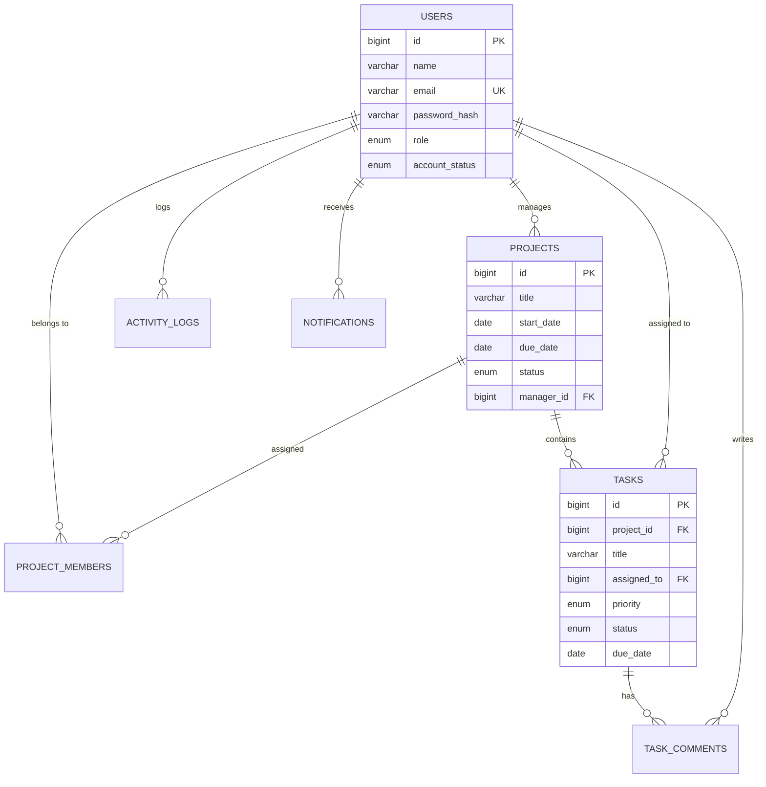

# ProManage Enterprise: Online Project Management Tool

[](https://www.oracle.com/java/)
[](https://maven.apache.org/)
[](https://www.mysql.com/)
[](https://jakarta.ee/specifications/servlet/6.0/)
[](https://getbootstrap.com/)
[](https://junit.org/junit5/)

A robust, enterprise-grade, responsive **Online Project Management Tool** built strictly with traditional enterprise Java technologies (**Java Servlets, JSP, JDBC, MySQL, and Maven**) following the **MVC (Model-View-Controller)** pattern. Designed specifically for college academic project reviews, software engineering practical exams, and enterprise team task delegation.

---

## Table of Contents
1. [Project Overview](#1-project-overview)
2. [Problem Statement & Objectives](#2-problem-statement--objectives)
3. [Main Features by Role](#3-main-features-by-role)
4. [Technology Stack](#4-technology-stack)
5. [System Architecture](#5-system-architecture)
6. [Database ER Diagram & Schema](#6-database-er-diagram--schema)
7. [Project Directory Structure](#7-project-directory-structure)
8. [Software Prerequisites](#8-software-prerequisites)
9. [MySQL Database Setup](#9-mysql-database-setup)
10. [Environment Variables & Configuration](#10-environment-variables--configuration)
11. [Maven Build Instructions](#11-maven-build-instructions)
12. [Tomcat 10.1+ Deployment Steps](#12-tomcat-101-deployment-steps)
13. [Initial Administrator Account & Demo Credentials](#13-initial-administrator-account--demo-credentials)
14. [How to Run the Application Locally](#14-how-to-run-the-application-locally)
15. [Automated Testing & Test Cases](#15-automated-testing--test-cases)
16. [User Interface & Layout Overview](#16-user-interface--layout-overview)
17. [Academic Review & Rubric Mapping](#17-academic-review--rubric-mapping)
18. [GitHub Repository Setup & Push Guide](#18-github-repository-setup--push-guide)

---

## 1. Project Overview

**ProManage Enterprise** is a centralized project tracking, delegation, and performance analytics web application. It connects three distinct tiers of users:
- **System Administrators:** Manage accounts, assign system roles, configure global preferences, and inspect system-wide audit logs.
- **Project Managers:** Create projects, define milestone timelines, assign developers to project rosters, delegate tasks with granular priorities, and inspect real-time completion reports.
- **Team Members:** View personal assigned task deliverables in a dedicated workspace, update execution statuses, append collaboration notes, and monitor project timelines.

---

## 2. Problem Statement & Objectives

### Problem Statement
Software engineering and IT teams often struggle with decentralized communication, spreadsheet-based task tracking, and lack of role-based security barriers. Many open-source platforms are bloated or overly complex, while simple prototypes lack real database persistence, session security, and proper architectural layers.

### Key Objectives
1. **Role-Based Access Control (RBAC):** Restrict access strictly so users cannot view or manipulate projects/tasks outside their permissions.
2. **True Enterprise Java Architecture:** Strict separation across Model, View, Controller, Service, and DAO layers with JDBC prepared statements.
3. **Real-Time Data Visualization:** Render dynamic, data-driven completion graphs and distribution donuts using Chart.js.
4. **Resilient Security:** Implement salted BCrypt password hashing, session fixation prevention, and anti-CSRF token verification.
5. **Academic Marking Rubric Adherence:** Explicitly demonstrate OOP principles (Encapsulation, Inheritance, Polymorphism, Interfaces, Collections, Exception Handling, Concurrency).

---

## 3. Main Features by Role

### A. Administrator Module
- **User Directory:** Searchable and paginated table displaying user names, emails, roles, account statuses, and creation timestamps.
- **User CRUD:** Add new user accounts, modify existing user details, and toggle active/inactive account statuses.
- **Deletion Safeguards:** Explicitly prevents deleting the currently logged-in administrator account and blocks removing the last active administrator.
- **Project Oversight:** System-wide visibility over all enterprise projects and assigned managers.
- **System Settings:** Configure application branding, default task priorities, session timeouts, and broadcast announcements.
- **Executive Analytics:** High-level metric cards (Total Users, Active Projects, Completed Tasks, Overdue Tasks) and Chart.js distribution charts.
- **Audit Logs:** System-wide immutable activity trail tracking user logins, creations, updates, and deletions.

### B. Project Manager Module
- **Managed Projects Overview:** Grid and table views showing title, timelines, manager details, team sizes, and completion percentages.
- **Project Management:** Create new projects, define start and due dates, set project status, and assign initial team members.
- **Task Delegation:** Create and assign tasks with 4 priority levels (`LOW`, `MEDIUM`, `HIGH`, `CRITICAL`) and 4 workflow states (`TODO`, `IN_PROGRESS`, `IN_REVIEW`, `COMPLETED`).
- **Team Roster Management:** Add available active team members to a project or remove members with real-time membership synchronization.
- **Progress Reports:** Dynamic visual reporting powered by Chart.js displaying project velocity, pending workloads, and task status distributions.

### C. Team Member Module
- **My Tasks View:** Filterable by status and priority, with instant text search across assigned deliverables.
- **Status Updates:** Update task progression with optional transition notes that automatically log into the task discussion thread.
- **Collaboration Thread:** View notes, blocker announcements, and manager instructions on a task-by-task basis.
- **Project Context:** Inspect overall project metadata, managers, and deadlines for projects the member belongs to.
- **Profile Management:** Update personal profile details and change account passwords with current password verification.
- **Activity Feed & Notifications:** Personal alert notifications and historical action timeline.

---

## 4. Technology Stack

| Layer | Technology | Details |
| :--- | :--- | :--- |
| **Backend** | Java 17+ (LTS) | Core enterprise Java logic |
| **Web Framework** | Jakarta Servlet 6.0 | Controller servlets (`HttpServlet`) |
| **Presentation** | JSP 3.1 & JSTL 3.0 | JavaServer Pages with Jakarta Standard Tag Library |
| **Database** | MySQL 8.0+ | Relational schema `project_management_db` |
| **Connection Pooling** | HikariCP 5.1.0 | High-performance, thread-safe JDBC pool |
| **Password Security** | BCrypt (`at.favre.lib:bcrypt`) | Salted password hashing (cost factor 12) |
| **Styling & UI** | Bootstrap 5.3 & CSS3 | Custom Indigo/Sapphire design system, responsive drawer |
| **Icons** | Bootstrap Icons 1.11 | Semantic SVG icons |
| **Charts** | Chart.js 4.4 | Doughnut and stacked bar charts |
| **JSON API** | Google Gson 2.10 | RESTful endpoints for Chart.js integrations |
| **Build Tool** | Apache Maven 3.9+ | Standard dependency resolution and WAR packaging |
| **Application Server** | Apache Tomcat 10.1+ | Jakarta EE 10 compatible server (or Embedded Tomcat runner) |
| **Unit Testing** | JUnit 5 & AssertJ | Automated business logic and validation tests |

---

## 5. System Architecture

The project strictly follows the **Model-View-Controller (MVC)** design pattern:

```
[ Web Browser ]
      |
      v
[ Filter Chain: UTF-8 -> AuthFilter -> RBACFilter -> CsrfFilter ]
      |
      v
[ Jakarta Servlet Controllers ]  (e.g., AuthController, ProjectController, TaskController)
      |
      v
[ Service Layer Interfaces ]     (e.g., UserService, ProjectService, TaskService)
      |
      +---> [ BackgroundJobExecutor ] (Multi-threaded async logging & alerts)
      |
      v
[ Data Access Objects (DAOs) ]   (e.g., UserDAOImpl, ProjectDAOImpl, TaskDAOImpl)
      |
      v
[ HikariCP Connection Pool ]
      |
      v
[ MySQL 8.0 Database: project_management_db ]
```

---

## 6. Database ER Diagram & Schema

The schema contains 8 relational tables normalized to 3NF.

### Entity Relationship Diagram


Detailed table specifications and constraints are documented in [docs/er-diagram.md](docs/er-diagram.md).

---

## 7. Project Directory Structure

```
JAVA Project/
├── pom.xml                               # Maven project definition and dependencies
├── .env.example                          # Environment variable configuration template
├── .gitignore                            # Standard Git ignore rules
├── mvn.cmd / mvnw.cmd                    # Maven wrapper scripts
├── database/
│   ├── schema.sql                        # DDL statements (tables, constraints, indexes)
│   └── seed.sql                          # Demo seed data with hashed BCrypt passwords
├── docs/
│   ├── architecture.md                   # Detailed architectural specification
│   ├── er-diagram.md                     # ER diagrams, table cardinalities, indexes
│   ├── testing.md                        # Verification matrix and automated test logs
│   ├── academic-review.md                # Mapping to college marking rubric
│   └── presentation/
│       ├── presentation_slides.md        # 16-slide presentation deck content
│       └── project_summary.md            # Viva / defense preparation Q&A guide
└── src/
    ├── main/
    │   ├── java/com/projectmanagement/
    │   │   ├── config/                   # DatabaseConnection, AppConfig, PasswordUtils
    │   │   ├── model/                    # POJOs: User, Project, Task, Enums, DTOs
    │   │   ├── dao/                      # DAO Interfaces and JDBC Impls
    │   │   ├── service/                  # Business Service Interfaces and Impls
    │   │   ├── controller/               # Jakarta Servlets (MVC Controllers)
    │   │   ├── filter/                   # Encoding, Auth, RBAC, CSRF Filters
    │   │   ├── exception/                # Domain Exception Hierarchy
    │   │   ├── util/                     # ValidationUtils, DateUtils, BackgroundJobExecutor
    │   │   └── server/                   # EmbeddedTomcatServer (Standalone Runner)
    │   ├── resources/                    # db.properties, logback.xml
    │   └── webapp/
    │       ├── assets/                   # CSS (app.css), JS (app.js, charts.js)
    │       ├── WEB-INF/
    │       │   ├── web.xml               # Servlet 6.0 deployment descriptor
    │       │   └── views/                # Modular JSP templates (admin, manager, member)
    │       └── index.jsp                 # Root dispatcher
    └── test/java/com/projectmanagement/  # Unit tests (UserServiceTest, ValidationTest, etc.)
```

---

## 8. Software Prerequisites

Before running the project, ensure you have:
1. **Java Development Kit (JDK):** Version 17, 21, or 26.
2. **Apache Maven:** Version 3.8+ (A bundled wrapper `mvn.cmd` is included in the project root).
3. **MySQL Server:** Version 8.0+ running on port `3306`.
4. **Apache Tomcat (Optional):** Version 10.1+ (Only required for standalone war deployment; alternatively, use the built-in embedded runner).

---

## 9. MySQL Database Setup

1. Start your local MySQL service.
2. Open MySQL Workbench or your terminal:
```bash
mysql -u root -p
```
3. Execute the schema script:
```sql
SOURCE database/schema.sql;
```
4. Seed the database with realistic demonstration data:
```sql
SOURCE database/seed.sql;
```

---

## 10. Environment Variables & Configuration

The application automatically reads configuration from environment variables, falling back to `src/main/resources/db.properties`.

Create a `.env` file or export environment variables:
```bash
# Database Configuration
export DB_HOST=localhost
export DB_PORT=3306
export DB_NAME=project_management_db
export DB_USERNAME=root
export DB_PASSWORD=your_mysql_password

# Server Port
export SERVER_PORT=8080
```

Alternatively, adjust `src/main/resources/db.properties` directly:
```properties
db.host=localhost
db.port=3306
db.name=project_management_db
db.username=root
db.password=root
```

---

## 11. Maven Build Instructions

Open PowerShell or terminal in the project root:

```bash
# Clean and compile all classes
.\mvn.cmd clean compile

# Run automated JUnit 5 test suite
.\mvn.cmd test

# Package standard deployable WAR artifact
.\mvn.cmd package
```

Upon successful build, the package artifact will be located at:
`target/project-management-tool.war`

---

## 12. Tomcat 10.1+ Deployment Steps

1. Build the WAR package using `.\mvn.cmd package`.
2. Locate the generated WAR file: `target/project-management-tool.war`.
3. Copy `project-management-tool.war` to your Apache Tomcat `webapps/` directory:
   - **Windows:** `C:\Program Files\Apache Software Foundation\Tomcat 10.1\webapps\`
   - **Linux/Mac:** `/opt/tomcat/webapps/`
4. Start Tomcat:
   - **Windows:** `bin\startup.bat`
   - **Linux/Mac:** `bin/startup.sh`
5. Open your browser and navigate to:
   `http://localhost:8080/project-management-tool/`

---

## 13. Initial Administrator Account & Demo Credentials

The database seeding script provisions 3 pre-configured user roles with verified BCrypt hashes. The login page also features **1-Click Quick Fill buttons** for examiners:

| Role | Email Address | Password | Sample Responsibilities |
| :--- | :--- | :--- | :--- |
| **Administrator** | `admin@promanage.com` | `Admin@123` | User CRUD, settings, audit trails, project oversight |
| **Project Manager** | `sarah.pm@promanage.com` | `Manager@123` | Create projects, assign tasks, review progress |
| **Project Manager** | `david.pm@promanage.com` | `Manager@123` | Manages banking portal revamp project |
| **Team Member (Dev)**| `alex.dev@promanage.com` | `Member@123` | Track "My Tasks", update status, add comments |
| **Team Member (QA)** | `michael.qa@promanage.com`| `Member@123` | QA testing tasks across active projects |
| **Team Member (UI)** | `sophia.ui@promanage.com` | `Member@123` | Design and frontend wireframing tasks |

---

## 14. How to Run the Application Locally

You can run the application in two ways:

### Option A: One-Click Embedded Tomcat Runner (Fastest & Easiest)
Run directly from your terminal using Maven:
```bash
.\mvn.cmd exec:java
```
Or execute the main class `com.projectmanagement.server.EmbeddedTomcatServer` from IntelliJ IDEA / Eclipse.

Access the application in your browser:
- **Application URL:** [http://localhost:8080/project-management-tool/](http://localhost:8080/project-management-tool/)
- **Login URL:** [http://localhost:8080/project-management-tool/login](http://localhost:8080/project-management-tool/login)

### Option B: External Tomcat 10.1 Server
Deploy `target/project-management-tool.war` as detailed in [Section 12](#12-tomcat-101-deployment-steps).

---

## 15. Automated Testing & Test Cases

The project incorporates 15 unit and integration tests verifying core business logic:

```bash
.\mvn.cmd test
```

Key verified test suites:
- **`PasswordUtilsTest`:** BCrypt hashing cost factor, correct hash verification, invalid password rejection.
- **`ValidationUtilsTest`:** Email regex pattern, user registration validation, project date boundaries (due date cannot precede start date).
- **`UserServiceTest`:** Successful authentication, wrong password rejection, inactive account lockout, self-deletion prevention, last admin deletion guard.
- **`ProjectServiceTest`:** Project creation, manager authorization barriers, admin access override.

Detailed test matrices are documented in [docs/testing.md](docs/testing.md).

---

## 16. User Interface & Layout Overview

The UI is built with a custom design system utilizing:
- **Aesthetic Palette:** Deep indigo (`#1e1b4b`), Sapphire blue (`#4f46e5`), Emerald green (`#10b981`), Clean slate (`#f8fafc`).
- **Responsive Navigation:** Fixed sidebar on desktop; responsive collapsible drawer toggle on mobile and tablet devices.
- **Interactive Visualizations:** Chart.js doughnut charts visualizing real-time task status distributions and horizontal stacked bars displaying project task velocities.
- **Micro-interactions:** Subtle hover elevation on metric cards, animated alert dismissals, and confirmation prompts on all destructive actions.

---

## 17. Academic Review & Rubric Mapping

This project explicitly satisfies all criteria of the college software engineering marking rubric:

1. **Encapsulation:** All models feature private fields, strong validation, and domain helper methods.
2. **Inheritance:** `BaseEntity` common abstraction and structured exception hierarchy (`AppException`).
3. **Polymorphism & Interfaces:** Service and DAO interfaces with decoupled implementations via `ServiceFactory`.
4. **Exception Handling:** Custom exception domain hierarchy (`ResourceNotFoundException`, `ValidationException`, `AuthorizationException`, `DatabaseException`).
5. **JDBC Best Practices:** HikariCP connection pool, 100% parameterized `PreparedStatement`, try-with-resources.
6. **Concurrency:** `BackgroundJobExecutor` utilizing managed daemon threads for non-blocking audit logging and notifications.

Refer to [docs/academic-review.md](docs/academic-review.md) for full rubric mapping with line-by-line source citations.

---

## 18. GitHub Repository Setup & Push Guide

To push this repository to your personal GitHub account:

1. Initialize Git in the project root:
```bash
git init
```

2. Add all files and create the initial commit:
```bash
git add .
git commit -m "feat: complete Online Project Management Tool enterprise application"
```

3. Create a new repository on [GitHub](https://github.com/new) named `online-project-management-tool`.

4. Link your remote repository and push:
```bash
git branch -M main
git remote add origin https://github.com/<your-username>/online-project-management-tool.git
git push -u origin main
```

---

## License
Developed for educational and academic project evaluation purposes. Licensed under the [MIT License](LICENSE).
