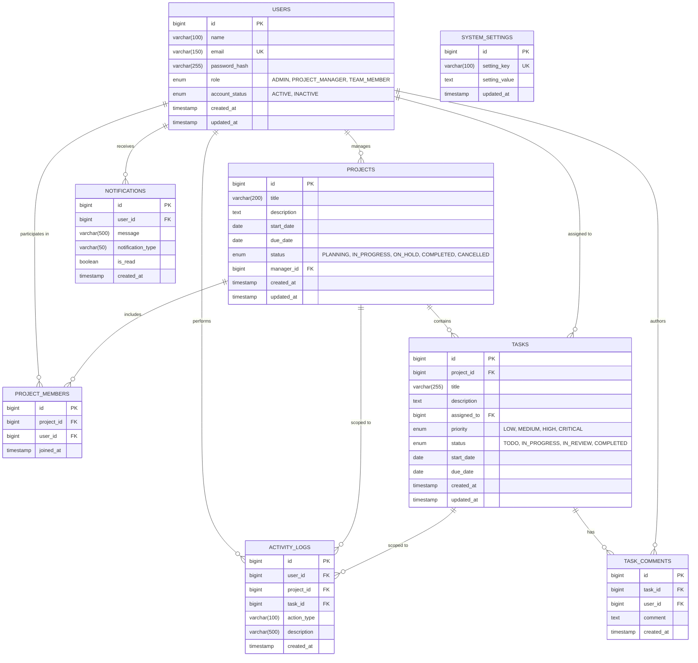

# Entity Relationship (ER) Diagram - Online Project Management Tool

## Database Name: `project_management_db`

The database schema is fully normalized up to 3NF (Third Normal Form) with primary keys, foreign keys, cascade rules, unique constraints, and optimized indexes.

## Table Relationships & Cardinalities

| Entity 1 | Relationship | Entity 2 | Cardinality | Foreign Key Constraint & Deletion Rule |
| :--- | :---: | :--- | :---: | :--- |
| `users` | Manages | `projects` | `1 : N` | `manager_id` -> `users(id)` (`ON DELETE RESTRICT`) |
| `projects` | Maps to | `project_members` | `1 : N` | `project_id` -> `projects(id)` (`ON DELETE CASCADE`) |
| `users` | Maps to | `project_members` | `1 : N` | `user_id` -> `users(id)` (`ON DELETE CASCADE`) |
| `projects` | Contains | `tasks` | `1 : N` | `project_id` -> `projects(id)` (`ON DELETE CASCADE`) |
| `users` | Assigned to | `tasks` | `1 : N` | `assigned_to` -> `users(id)` (`ON DELETE SET NULL`) |
| `tasks` | Has | `task_comments` | `1 : N` | `task_id` -> `tasks(id)` (`ON DELETE CASCADE`) |
| `users` | Authors | `task_comments` | `1 : N` | `user_id` -> `users(id)` (`ON DELETE CASCADE`) |
| `users` | Generates | `activity_logs` | `1 : N` | `user_id` -> `users(id)` (`ON DELETE CASCADE`) |
| `users` | Receives | `notifications` | `1 : N` | `user_id` -> `users(id)` (`ON DELETE CASCADE`) |

## Integrity & Indexing Strategy
- **Unique Constraints:**
  - `users(email)`: Ensures no duplicate user registration.
  - `project_members(project_id, user_id)`: Prevents duplicate membership assignments.
  - `system_settings(setting_key)`: Unique configuration keys.
- **Indexes:**
  - `idx_users_role`, `idx_users_status`, `idx_users_email`
  - `idx_projects_manager`, `idx_projects_status`, `idx_projects_dates`
  - `idx_tasks_project`, `idx_tasks_assigned`, `idx_tasks_status`, `idx_tasks_priority`, `idx_tasks_due_date`
  - `idx_comments_task`, `idx_logs_user`, `idx_notifications_user`
